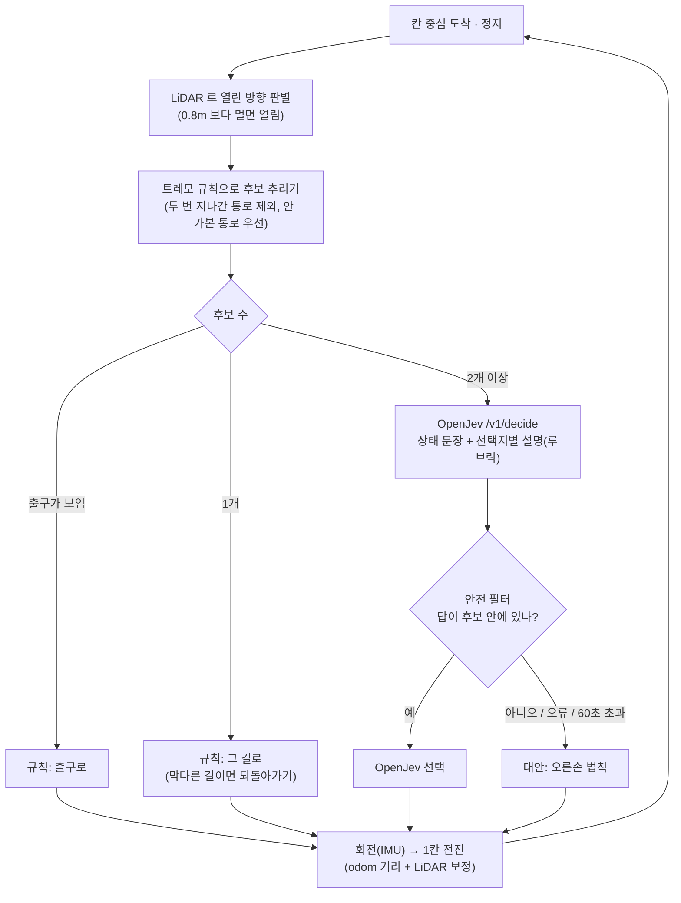

# OpenJev 미로 탐색 검증 결과 및 장단점

> **한 줄 결론** — OpenJev 를 갈림길 판단에 붙이자 미로 탈출 경로가 **29칸 → 15칸(최단)** 으로 줄었다.
> 하지만 같은 결과는 “출구에 가까워지는 쪽” 이라는 **단순 규칙으로도 나온다.**
> OpenJev 의 진짜 가치는 경로를 더 잘 찾는 데 있지 않다. 판단 기준을 **코드가 아닌 문장(루브릭)으로 바꾸고 근거를 확률로 남길 수 있다는 점**에 있다.
> 대신 **느리다**(갈림길 한 번에 약 19~22초).
>
> 검증일: 2026-10-12 · 환경: Mac(Apple Silicon) Docker Desktop, `ros2-dev`(ROS 2 Jazzy), OpenJev Docker CPU

## 목차

1. [무엇을 검증했나](#1-무엇을-검증했나)
2. [어떻게 동작하나](#2-어떻게-동작하나)
3. [검증 결과](#3-검증-결과)
4. [검증 중 발견한 문제와 해결](#4-검증-중-발견한-문제와-해결)
5. [OpenJev 를 쓸 때의 장점](#5-openjev-를-쓸-때의-장점)
6. [OpenJev 를 쓸 때의 단점](#6-openjev-를-쓸-때의-단점)
7. [언제 쓰고 언제 쓰지 말아야 하나](#7-언제-쓰고-언제-쓰지-말아야-하나)
8. [개선 제안](#8-개선-제안)
9. [직접 재현하기](#9-직접-재현하기)

---

## 1. 무엇을 검증했나

**질문**: 로봇이 미로에서 갈림길을 만났을 때, OpenJev(NLI 판정 모델)에게 “어느 쪽으로 갈까?” 를 물으면 더 잘 빠져나가는가?

| 항목 | 내용 |
|---|---|
| 미로 | 5m × 5m, 1m 칸 5×5 격자, 통로 폭 0.9m, 고리 없는 완전 미로 (seed 4) |
| 출발 / 출구 | 왼쪽 아래 칸 (0,0) / 오른쪽 위 칸 (4,4) 의 동쪽 벽 구멍 |
| 이론값 | 최단 경로 **14칸**, 오른손 법칙 **28칸** (+ 출구로 나가는 1칸) |
| 로봇 | TurtleBot3 burger (LiDAR 360개, 0.12~3.5m, 5Hz / IMU) |
| OpenJev | `qwen3.5-4b-nli-v5`, Docker CPU, ros2-dev 안에서 `http://host.docker.internal:31001` 로 호출 |

```
+---+---+---+---+---+
|           |     E      ← 출구 (4,4) 동쪽
+---+   +   +   +   +
|       |   |   |   |
+   +---+   +---+   +
|       |           |
+---+   +---+---+   +
|       |       |   |
+   +---+   +---+   +
| S |               |    ← 출발 (0,0)
+---+---+---+---+---+
```

---

## 2. 어떻게 동작하나

**OpenJev 에게 운전대를 맡기지 않는다.** 규칙이 할 수 있는 일은 규칙이 하고, OpenJev 는 “고르기” 만 한다.



OpenJev 에게 실제로 보낸 질문 (갈림길 (1,4)):

```text
state: A wheeled robot is exploring a 5 by 5 grid maze and must reach the exit. ...
       The robot is in column 1, row 4, facing north. The exit is in column 4, row 4,
       on the outer east wall, which is to the east of the robot. Open passages from here: west, east.
question: Which open passage should the robot take to reach the exit with the fewest moves?
rubric:   west → "Goes west; moves farther from the exit; this passage is never explored."
          east → "Goes east; moves closer to the exit; this passage is never explored."
```

응답: `east 1.00, west 0.00` → 동쪽 선택.

---

## 3. 검증 결과

### 3.1 미로 탈출 비교

| # | 방식 | 화면 | 결과 | 이동 칸 | 걸린 시간 | OpenJev 호출 |
|---|---|---|---|---|---|---|
| A | 오른손 법칙 (칸 단위, `use_openjev:=false`) | 없음 | ✅ 탈출 | 29 | 290초 | 0 |
| B | **OpenJev 판단** (칸 단위) | 없음 | ✅ 탈출 | **15** | **197초** | 2회, 평균 22.1초 |
| C | **OpenJev 판단** (칸 단위) | **noVNC 화면** | ✅ 탈출 | **15** | **197초** | 2회, 평균 18.9초 |
| D | 벽 따라가기 (연속 P 제어, `wall_follower`) | 없음 | ✅ 탈출 | — | 211.8초 ※ | 0 |
| E | OpenJev 판단 — 코드 리뷰 수정 후 재실행 (회귀 확인) | 없음 | ✅ 탈출 | 15 | 208초 | 2회, 평균 22.0초 |
| F | OpenJev **연결 불가** (일부러 틀린 주소) → 대안 동작 확인 | 없음 | ✅ 탈출 | 29 | 313초 | 3회 실패 → 3회 모두 오른손 대안 |
| — | (참고) “출구에 가까운 쪽” 단순 규칙 — 칸 단위 계산만 | — | ✅ | 15 | — | 0 |

※ D 는 시뮬레이션 시계 기준, A~C 는 실제 시계 기준. 시뮬레이션 실행 속도(RTF)가 약 0.94~1.0 이라 두 값의 차이는 작다.

**읽는 법**

- **B vs A**: OpenJev 판단으로 이동 거리는 **48% 감소**(29 → 15칸)했다. 15칸은 최단 경로 14칸에 출구로 나가는 1칸을 더한 값이다. 시간은 **32% 감소**(290 → 197초)했지만, 197초 중 약 40초는 OpenJev 응답을 **멈춰서 기다린 시간**이다.
- **C**: noVNC 화면을 켠 실제 데스크톱에서도 같은 경로로 탈출했다. 화면에서 로봇이 초록 출구 표시 위에 멈춘 것을 확인했다.
- **F**: OpenJev 가 죽어 있어도 갈림길마다 오른손 법칙으로 넘어가 끝까지 탈출했다 → “OpenJev 없이도 동작” 확인.
- **참고 행**: 루브릭에 “closer to the exit” 를 넣었기 때문에, 그 문장을 그대로 규칙으로 쓰면 **OpenJev 없이도 15칸**이 나온다. 이번 미로에서 OpenJev 는 **더 똑똑한 길을 찾은 것이 아니라, 문장으로 준 기준을 정확히 따른 것**이다.

### 3.2 OpenJev 판단 내역 (B, C 공통)

| 갈림길 | 후보 | OpenJev 확률 | 선택 | 오른손 법칙이었다면 |
|---|---|---|---|---|
| (1,4) | 서 / 동 | 서 0.00 · **동 1.00** | 동 | 동 (같음) |
| (4,2) | 북 / 남 | **북 1.00** · 남 0.00 | 북 → 출구 직행 | 남 → 막다른 길 2곳을 돌고 옴 (+14칸) |

차이는 (4,2) **한 번의 판단**에서 났다.

### 3.3 OpenJev 응답 속도

| 조건 | 선택지 수 | 응답 시간 |
|---|---|---|
| Mac 에서 curl, 첫 호출 | 4 | 27.2초 |
| Mac 에서 curl, 반복 | 3 | 9.9 ~ 10.8초 (선택지당 약 3.3초) |
| 시뮬레이션 중 (Gazebo 와 CPU 경쟁, 화면 없음) | 2 | 평균 22.1초 |
| 시뮬레이션 중 (화면 켬) | 2 | 평균 18.9초 |

→ **Gazebo 와 같은 Mac CPU 를 나눠 쓰면 선택지당 약 10초**까지 느려진다.

### 3.4 기타 검증

| 항목 | 결과 |
|---|---|
| 단위 테스트 (LiDAR 전처리, 방위 계산, 트레모 표시, 안전 필터, 루브릭 형식, 응답 형식 검사, 미로 탈출 시뮬레이션) | 12개 모두 통과 |
| OpenJev 연결 확인 (`/health`) | ros2-dev 컨테이너 → `host.docker.internal:31001` 정상 |
| 안전 필터 | 단위 테스트로 확인: OpenJev 가 막힌 방향에 0.9 를 줘도 열린 후보 안에서만 고른다 |
| 동시 실행 격리 | 실행마다 `ROS_DOMAIN_ID=99` + 별도 `GZ_PARTITION` → 화면용 시뮬레이션과 섞이지 않음 |
| obstacle_avoider 3분 주행 | ✅ 충돌 없음 (최소 거리 0.165m, 아래 §3.5) |

### 3.5 장애물 회피 3분 주행 (roadmap Step 2 완료 기준)

미로 안에서 `obstacle_avoider` 를 180초 동안 돌리며 전체 LiDAR 최소 거리를 기록했다.

| 항목 | 결과 |
|---|---|
| 주행 시간 | 180초 (LiDAR 838회 수신, 약 4.7Hz) |
| 전체 방향 LiDAR 최소 거리 | **0.165m** — 몸체가 벽에 닿으면 약 0.1m 이하로 떨어지므로 **충돌 없음** |
| 주행 거리 (odom) | 약 20.6m (odom 은 회전 때 오차가 있으므로 참고값) |
| 판정 | ✅ roadmap Step 2 완료 기준(3분 무충돌) 충족 — 단, `turtlebot3_world` 가 아닌 **미로 월드**에서 측정 |

---

## 4. 검증 중 발견한 문제와 해결

| # | 증상 | 원인 | 해결 |
|---|---|---|---|
| 1 | 로봇이 벽을 “열린 통로” 로 보고 미로 밖으로 나가려 함 | 제자리 회전 때 바퀴가 미끄러져 **odom 의 방향이 실제와 크게 다름** (odom 179.5° / 실제 115°, Gazebo 참값으로 확인) | 방향은 **IMU**, 이동 거리는 odom 위치 **변화량의 크기**만, 현재 칸은 **이동 칸 수**로 계산. 앞 벽이 보이면 **벽까지 거리**로 정지, 옆 벽으로 **통로 가운데** 유지 |
| 2 | 화면(GUI)을 켜면 1칸 만에 “갈 곳 없음” 으로 정지 | GUI 가 CPU 약 1.6코어 사용 → 제어가 늦어 90° 회전이 **121° 까지 지나침** → 비스듬히 선 채 앞 벽을 “도착” 으로 오판 | 회전은 목표 ±0.03rad 안에 **0.25초 연속** 머물러야 완료로 판정, 최대 회전 속도 1.2 → 0.8rad/s. 전진 중 방향 오차가 크면 다시 회전 |
| 3 | 첫 호출이 느림 (27초) | OpenJev CPU 컨테이너 예열 + 선택지 4개 | 선택지를 실제 열린 통로로만 제한 (갈림길은 보통 2개) |

| 4 | (코드 리뷰) 다시 회전하면 이동 거리가 0 부터 다시 세어짐 → 칸을 지나칠 수 있음 | 회전 완료 때마다 출발점을 새로 기록 | 출발점은 방향을 결정할 때 한 번만 기록 |
| 5 | (코드 리뷰) 출발 방향이 계속 막혀 있으면 회전 ↔ 전진을 무한 반복 | 재시도 횟수 제한 없음 | 2번 막히면 그 통로를 후보에서 빼고 다시 판단 |
| 6 | (코드 리뷰) OpenJev 응답 형식이 이상하면 판단 대기 상태에서 멈춤 | 스레드의 예외 처리 범위가 좁음 | 모든 예외를 잡아 대안으로 넘기고, 응답 형식 검사 추가 |
| 7 | (코드 리뷰) 너무 가까운 벽(측정 최소 거리 미만)을 ‘열림’ 으로 볼 수 있음 | 범위 밖 값을 버려서 구간 전체가 비면 최대 거리(3.5m)로 계산 | 범위 밖 가까운 값은 최소 거리(0.12m)로 취급 |
| 8 | (코드 리뷰) `x_pose:=-2` 처럼 정수로 주면 노드가 시작되지 않음 | launch 인자 문자열이 int 로 해석 | `ParameterValue(..., value_type=float/bool)` 로 타입 고정 (E 실행에서 확인) |

> 1번은 OpenJev 와 무관하지만 **가장 큰 문제**였다. 판단이 아무리 좋아도 “지금 어디에 있고 어디가 열려 있는가” 가 틀리면 소용없다.

---

## 5. OpenJev 를 쓸 때의 장점

| 장점 | 설명 | 이번 검증에서의 근거 |
|---|---|---|
| **판단 기준을 문장으로 바꿀 수 있다** | “출구에 가까운 쪽”, “안 가본 쪽”, “위험 구역 피하기” 같은 기준을 루브릭 문장만 고쳐서 바꾼다. 코드 수정·재빌드가 필요 없다 | 루브릭 한 줄(`moves closer to the exit`)로 29칸 → 15칸 |
| **근거가 확률로 남는다** | 선택지마다 확률이 나와 “왜 그쪽을 골랐나” 를 기록·분석할 수 있다. 확신이 낮으면 대안으로 넘기는 기준으로도 쓴다 | `/jev/decision` 토픽에 후보·확률·지연 시간 기록 |
| **결과가 결정적이다** | 같은 입력이면 항상 같은 답. 선택지 순서를 바꿔도 같다 | B, C 두 실행의 판단이 완전히 같음 |
| **로컬에서 돈다** | 외부 API 없이 Docker 하나로 실행. 인터넷·비용·데이터 유출 걱정이 없다 | Mac Docker CPU 로 동작 |
| **규칙과 잘 섞인다** | 닫힌 선택지에서 고르기만 하므로 안전 필터로 감싸기 쉽다. 엉뚱한 답이 나와도 버리면 된다 | 안전 필터 + 오른손 대안 구조 |
| **복잡한 상태를 한 번에 본다** | 상태를 문장이나 JSON 으로 주면 여러 조건(목표 방향, 탐색 이력, 정책)을 함께 고려한다 | 위치·출구·탐색 이력을 한 문장으로 전달 |

## 6. OpenJev 를 쓸 때의 단점

| 단점 | 설명 | 이번 검증에서의 근거 | 완화 방법 |
|---|---|---|---|
| **느리다** | CPU 에서 선택지당 약 3~10초. 로봇은 멈춰서 기다려야 한다 | 갈림길당 19~22초, 전체 197초 중 약 40초 대기 | MPS 네이티브(`:31000`) 사용, 캐시, 갈림길에서만 호출 |
| **Gazebo 와 CPU 를 나눠 쓴다** | 같은 Mac 에서 돌리면 서로 느려진다 | 단독 3.3초/선택지 → 시뮬레이션 중 약 10초/선택지 | OpenJev 를 다른 장치·GPU 로 분리 |
| **스스로 보지 못한다** | 센서 해석은 못 한다. 규칙이 만든 문장만 판단한다. 문장이 틀리면 판단도 틀린다 | odom 오류 상태였다면 OpenJev 도 틀린 상황을 판단했을 것 | 인식(LiDAR·IMU)은 규칙으로 정확하게 |
| **단순 규칙보다 꼭 낫지는 않다** | 루브릭에 담은 기준을 규칙으로 쓰면 같은 결과가 더 빨리 나온다 | “가까운 쪽” 규칙도 15칸 | 규칙으로 표현하기 어려운 판단에만 쓴다 |
| **한 번에 한 요청** | 내부 잠금으로 순차 처리. 로봇이 여러 대면 줄을 선다 | (단일 로봇이라 미발생) | 판단 서비스에서 대기열·우선순위·캐시 관리 |
| **확률이 보정되지 않았다** | 1.00 / 0.00 처럼 극단값이 자주 나와 “확신도” 로 그대로 믿기 어렵다 | 두 판단 모두 1.00 | 임계값은 실제 데이터로 따로 정한다 |
| **영어 모델 · 인젝션 취약** | 한국어 정확도 미검증. 입력에 지시문이 섞이면 정확도가 크게 떨어진다 (0.83 → 0.47) | 상태 문장을 코드로만 생성해 영향 없음 | 사용자 텍스트를 state 에 넣지 않는다 |

## 7. 언제 쓰고 언제 쓰지 말아야 하나

| 쓰면 좋은 곳 | 쓰지 말아야 할 곳 |
|---|---|
| 드물게 일어나는 **고수준 선택** (갈림길, 임무 순서, 목적지 고르기) | **실시간 제어** (조향, 속도, 충돌 회피) — 50ms 안에 답해야 함 |
| 기준이 자주 바뀌거나 **사람이 문장으로 정의**하는 정책 | 수식 한 줄로 끝나는 판단 (거리 비교, 임계값) |
| 운영 데이터의 **분류·검증** (센서 이상 보고 분류, 실행 결과 판정) | 안전에 직결되는 **단독 결정** (반드시 규칙과 함께) |
| 판단 근거를 **기록·감사**해야 하는 경우 | 사용자 입력 텍스트가 섞이는 판단 |

이번 구조(규칙이 후보를 만들고 → OpenJev 가 고르고 → 규칙이 거른다)는 위 원칙을 그대로 따른 것이다.

## 8. 개선 제안

| 우선순위 | 제안 | 기대 효과 |
|---|---|---|
| 1 | OpenJev 를 **Mac 네이티브 MPS(`:31000`)** 로 실행 | 가이드 기준 Docker CPU 보다 약 5배 빠름 → 갈림길당 수 초 |
| 2 | 판단 결과 **캐시** `(미로 버전, 칸, 후보, 탐색 표시, 정책 버전)` | 같은 미로 반복 실행 시 호출 0회 |
| 3 | **규칙으로 어려운 기준**으로 루브릭 실험 (예: “최근 충돌이 난 구역은 피한다”, “배터리가 낮으면 가까운 출구”) | OpenJev 고유의 가치 검증 |
| 4 | 확신도 임계값 (예: 최고 확률 < 0.6 이면 규칙 대안) | 애매한 판단을 규칙에 넘김 |
| 5 | **seed 를 바꾼 미로 여러 개**로 반복 실험 | 한 미로 결과의 우연성 제거 |
| 6 | 판단 서비스 분리 — [백엔드 아키텍처 문서](미로_센서_운영관리_백엔드_아키텍처.md) 참고 | 다중 로봇, 기록, 정책 관리 |

---

## 9. 직접 재현하기

```bash
# 0) OpenJev 가 떠 있는지 (Mac)
curl -s http://127.0.0.1:31001/health

# 1) 빌드 (ros2-dev 컨테이너 안)
cd ~/ros2_ws && colcon build --packages-select turtlebot3_maze && source install/setup.bash

# 2) 실행 — noVNC 화면에서 보려면 데스크톱 터미널에서
ros2 launch turtlebot3_maze maze.launch.py navigator:=jev_navigator                     # OpenJev 판단
ros2 launch turtlebot3_maze maze.launch.py navigator:=jev_navigator use_openjev:=false  # 오른손 법칙
ros2 launch turtlebot3_maze maze.launch.py navigator:=wall_follower                     # 연속 벽 따라가기

# 3) 판단 내역 보기 (다른 터미널)
ros2 topic echo /jev/decision

# 4) 단위 테스트
cd ~/ros2_ws/src/turtlebot3_maze && python3 -m pytest -q test
```

| 파일 | 내용 |
|---|---|
| `ros2_ws/src/turtlebot3_maze/turtlebot3_maze/jev_navigator.py` | OpenJev 판단 + 규칙 안전장치 노드 |
| `ros2_ws/src/turtlebot3_maze/turtlebot3_maze/maze_logic.py` | 트레모 규칙, 루브릭 생성, 안전 필터 (ROS 없이 테스트 가능) |
| `ros2_ws/src/turtlebot3_maze/turtlebot3_maze/openjev_client.py` | OpenJev `/v1/decide` 호출 |
| `ros2_ws/src/turtlebot3_maze/scripts/gen_maze_world.py` | 미로 생성기 (seed → SDF) |
| `ros2_ws/src/turtlebot3_maze/launch/maze.launch.py` | 미로 + 로봇 + 주행 노드 한 번에 실행 |
