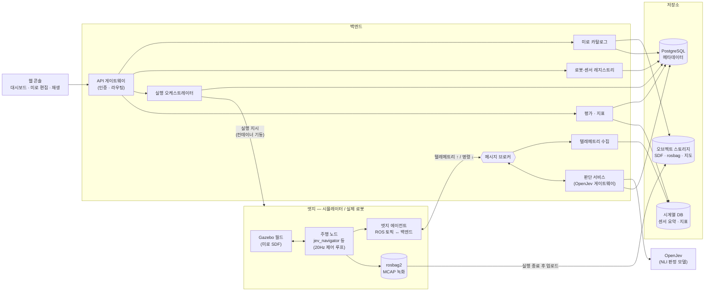
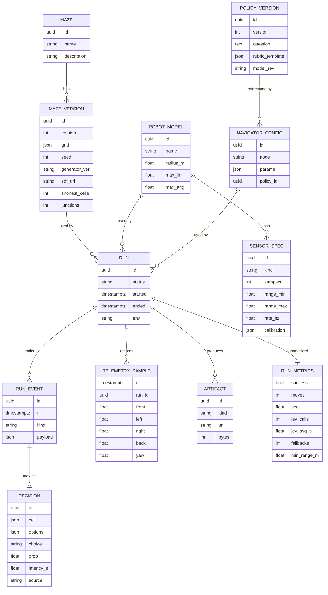
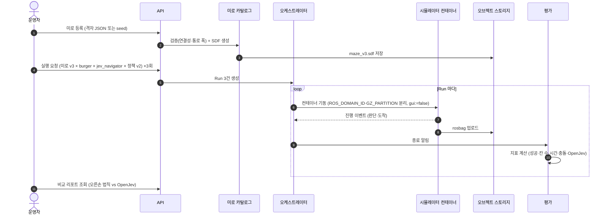
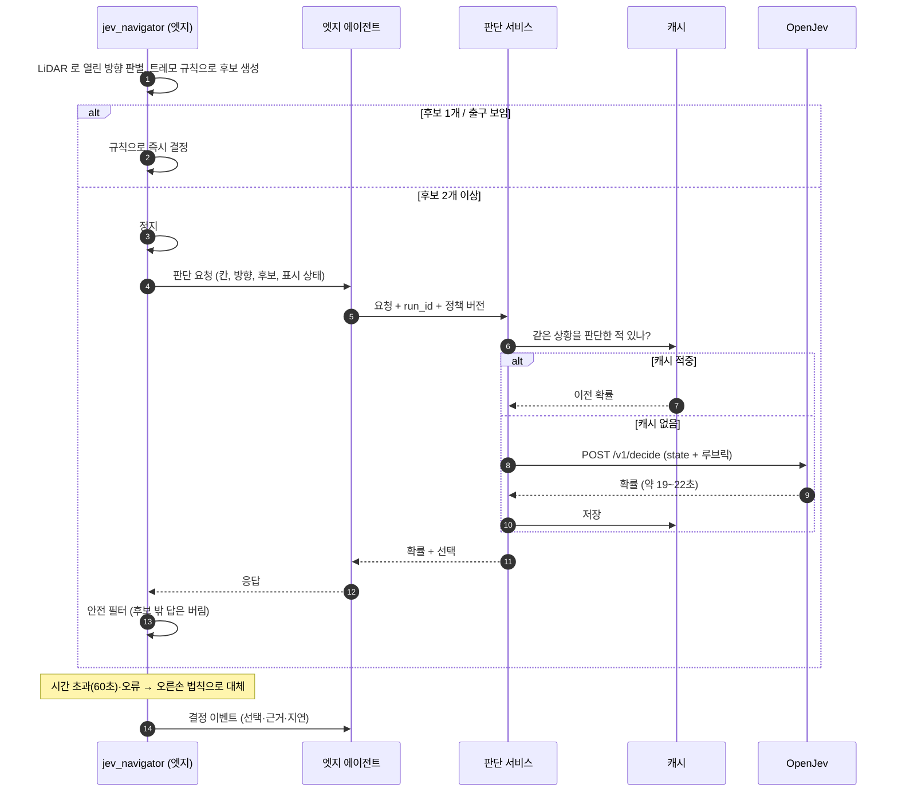

# 미로 · 센서 운영관리 백엔드 아키텍처 (기초안)

> **목적** — 지금은 미로 1개, 로봇 1대, 노드 1개를 손으로 띄워 검증했다.
> 이것을 **여러 미로 × 여러 로봇/센서 × 여러 주행 방식**으로 늘려 반복 실행·비교·관리하려면 백엔드가 필요하다.
> 이 문서는 그 백엔드의 **기초 구조**(무엇을 어디에 두고, 데이터가 어떻게 흐르는지)를 정의한다.
>
> 근거가 된 검증 결과는 [OpenJev_미로탐색_검증결과_및_장단점.md](OpenJev_미로탐색_검증결과_및_장단점.md) 에 있다.
> 이 문서는 **설계안**이며, 아직 구현하지 않았다.

## 목차

1. [설계 원칙](#1-설계-원칙)
2. [전체 구성](#2-전체-구성)
3. [구성 요소별 역할](#3-구성-요소별-역할)
4. [데이터 모델](#4-데이터-모델)
5. [주요 흐름](#5-주요-흐름)
6. [API 초안](#6-api-초안)
7. [기술 선택 (MVP → 확장)](#7-기술-선택-mvp--확장)
8. [비기능 요구사항](#8-비기능-요구사항)
9. [현재 저장소와의 연결](#9-현재-저장소와의-연결)
10. [단계별 구축 계획](#10-단계별-구축-계획)

---

## 1. 설계 원칙

검증에서 얻은 사실이 그대로 원칙이 된다.

| # | 원칙 | 근거 (검증에서 확인한 사실) |
|---|---|---|
| 1 | **제어 루프는 로봇(엣지) 안에서 끝낸다.** 백엔드는 실시간 제어에 끼어들지 않는다 | 제어 주기 20Hz(50ms) vs OpenJev 응답 약 19~22초 |
| 2 | **OpenJev 는 '조언자'** — 규칙이 후보를 만들고, OpenJev 는 고르기만, 규칙이 다시 거른다 | 가이드 §7(단독 결정권 금지), 실제로 열려 있지 않은 방향을 고를 가능성 |
| 3 | **OpenJev 가 없어도 동작해야 한다** (시간 초과·오류 시 규칙 기반 대안) | CPU 버전은 느리고 요청을 한 번에 하나만 처리 |
| 4 | **센서 원본은 버리지 않는다** — 원본(rosbag)과 요약(지표)을 따로 저장 | odom 방향 오류(179° vs 실제 115°)는 원본을 다시 봐야 찾을 수 있었다 |
| 5 | **미로·정책(루브릭)·파라미터는 버전으로 관리한다** | 같은 결과를 재현하려면 seed, 루브릭 문구, 임계값이 모두 필요 |
| 6 | **사용자 텍스트를 판단 입력(state)에 섞지 않는다** | OpenJev 는 프롬프트 인젝션에 취약 (정확도 0.83 → 0.47) |

---

## 2. 전체 구성



**한 줄 요약**: 엣지는 **움직이고 기록**하고, 백엔드는 **준비·판단 보조·저장·비교**를 맡는다.

---

## 3. 구성 요소별 역할

| 구성 요소 | 하는 일 | 갖고 있는 데이터 | 지금 저장소의 대응물 |
|---|---|---|---|
| **미로 카탈로그** | 미로 등록·버전 관리, 격자 정의 → SDF 생성, 최단 경로·갈림길 수 같은 난이도 지표 계산 | 격자 JSON, seed, 생성기 버전, SDF 파일 | `scripts/gen_maze_world.py`, `worlds/maze.sdf` |
| **로봇·센서 레지스트리** | 로봇 모델과 센서 사양 관리 (LiDAR 개수·범위·주기, IMU 유무, 보정값) | 모델명, 센서 스펙, 보정 파라미터 | `TURTLEBOT3_MODEL=burger`, `wall_center=0.47` 등 실측값 |
| **실행 오케스트레이터** | “미로 × 로봇 × 주행 방식 × 파라미터” 조합을 받아 시뮬레이터 컨테이너를 띄우고, 끝나면 정리 | 실행(Run) 요청·상태 | `run_maze.sh` 같은 수동 스크립트 |
| **판단 서비스 (OpenJev 게이트웨이)** | 로봇의 판단 요청을 받아 OpenJev 호출, **대기열·시간 초과·캐시·감사 로그** 처리, 정책(루브릭) 버전 적용 | 판단 요청/응답, 확률, 지연 시간, 정책 버전 | `maze_logic.build_decide_request`, `openjev_client.py` |
| **텔레메트리 수집** | 엣지에서 올라온 요약 데이터를 시계열 DB 에 적재 | 위치, 구간별 거리, 상태 전이, 판단 이벤트 | `/jev/decision` 토픽 |
| **평가 · 지표** | 실행 결과를 지표로 계산하고 방식끼리 비교 | 성공 여부, 이동 칸 수, 시간, 충돌, OpenJev 호출 수·지연 | 검증 결과 표 (수기) |
| **엣지 에이전트** | ROS 토픽을 골라 백엔드로 보내고, 백엔드의 판단 응답을 ROS 로 전달. 연결이 끊겨도 로봇은 계속 동작 | 전송 버퍼 | (없음 — 신규) |
| **웹 콘솔** | 미로 편집, 실행 요청, 실시간 상태, 녹화 재생, 비교 리포트 | — | noVNC 화면 (수동 확인) |

### 판단 서비스를 따로 두는 이유

지금은 로봇 노드가 OpenJev 를 직접 부른다. 로봇이 여러 대가 되면 문제가 생긴다.

| 문제 | 직접 호출 시 | 판단 서비스를 두면 |
|---|---|---|
| OpenJev 는 요청을 **한 번에 하나만** 처리 | 로봇끼리 경쟁, 누가 얼마나 기다리는지 모름 | 대기열 + 우선순위 + 대기 시간 측정 |
| 같은 상황을 반복 질문 | 매번 19~22초 소비 | `(미로 버전, 칸, 후보, 정책 버전)` 으로 캐시 → 즉시 응답 |
| 루브릭 문구 수정 | 노드 코드 수정·재배포 | 정책 버전만 바꿔 배포, A/B 비교 |
| 판단 근거 추적 | 로그 파일을 뒤져야 함 | 요청·확률·선택·대안 사용 여부를 DB 에 남김 |
| 보안 | OpenJev 는 인증 없음 | 게이트웨이 뒤에 숨기고 인증·호출량 제한 |

---

## 4. 데이터 모델



| 엔터티 | 핵심 포인트 |
|---|---|
| `MAZE_VERSION` | 격자 JSON 이 **원본**, SDF 는 생성물. seed·생성기 버전을 함께 저장해 재현 가능하게 |
| `SENSOR_SPEC.calibration` | `wall_center=0.47m` 처럼 **실측으로 정한 값**을 센서 단위로 보관 |
| `POLICY_VERSION` | OpenJev 질문 문구·루브릭 템플릿·모델 리비전(`a2044801`). 문구가 바뀌면 새 버전 |
| `DECISION.source` | `openjev` / `rule:외길` / `rule:출구 보임` / `fallback:...` — 누가 결정했는지 |
| `TELEMETRY_SAMPLE` | 360개 원본이 아니라 **구간 요약**(앞·좌·우·뒤)만. 원본은 rosbag 으로 |
| `RUN_METRICS` | 비교 리포트의 기준. 지금 검증 결과 표의 열과 같다 |

---

## 5. 주요 흐름

### 5.1 미로 등록 → 실행 → 비교



> **격리**: 이번 검증에서 `ROS_DOMAIN_ID` 와 `GZ_PARTITION` 을 실행마다 다르게 주어 동시 실행해도 섞이지 않음을 확인했다. 오케스트레이터는 이 두 값을 실행마다 자동 배정한다.

### 5.2 갈림길 판단 (로봇 ↔ 판단 서비스 ↔ OpenJev)



### 5.3 센서 데이터의 두 갈래

| 갈래 | 내용 | 주기 | 저장 위치 | 용도 |
|---|---|---|---|---|
| **요약 (실시간)** | 구간별 거리 4개, yaw, 상태, 판단 이벤트 | 1~5Hz | 시계열 DB | 대시보드, 지표 계산 |
| **원본 (사후)** | `/scan` 360개, `/imu`, `/odom`, `/cmd_vel`, `/tf` | 원래 주기 | rosbag2(MCAP) → 오브젝트 스토리지 | 문제 재현, 알고리즘 재평가 |

---

## 6. API 초안

| 메서드 | 경로 | 설명 |
|---|---|---|
| `POST` | `/mazes` | 미로 등록 (격자 JSON 또는 seed) |
| `GET` | `/mazes/{id}/versions/{v}` | 미로 버전 조회 (격자, 난이도 지표, SDF 링크) |
| `POST` | `/robots` · `/robots/{id}/sensors` | 로봇·센서 사양 등록 |
| `POST` | `/policies` | OpenJev 정책(질문·루브릭 템플릿) 새 버전 |
| `POST` | `/runs` | 실행 요청 (미로 버전, 로봇, 주행 노드, 파라미터, 정책, 반복 횟수) |
| `GET` | `/runs/{id}` · `/runs/{id}/events` | 실행 상태 · 판단 이벤트 목록 |
| `GET` | `/runs/{id}/artifacts` | rosbag·지도 다운로드 링크 |
| `GET` | `/reports/compare?runs=a,b,c` | 실행 간 지표 비교 |
| `POST` | `/decisions` | (엣지 → 판단 서비스) 갈림길 판단 요청 |

판단 요청 본문 예시 — 지금 `jev_navigator` 가 만드는 내용을 그대로 옮긴 것:

```json
{
  "run_id": "…",
  "policy_version": 2,
  "cell": [1, 4],
  "heading": "N",
  "options": ["W", "E"],
  "marks": {"[1,4]-W": 0, "[1,4]-E": 0},
  "exit_cell": [4, 4],
  "timeout_s": 60
}
```

응답 예시:

```json
{"choice": "E", "probabilities": {"west": 0.00, "east": 1.00},
 "source": "openjev", "latency_s": 19.0, "cached": false}
```

> state 문장은 **판단 서비스가 정책 템플릿으로 조립**한다. 엣지는 숫자·기호만 보낸다 → 사용자 텍스트가 섞일 길이 없다(원칙 6).

---

## 7. 기술 선택 (MVP → 확장)

| 영역 | MVP (지금 규모: 로봇 1~3대, 맥 1대) | 확장 (로봇 수십 대, 서버) | 비고 |
|---|---|---|---|
| ROS ↔ 백엔드 | `rosbridge_suite` (WebSocket JSON) 또는 Python 에이전트 노드 + HTTP | Zenoh (`rmw_zenoh`, Jazzy 지원) 또는 MQTT | 처음엔 단순한 것부터 |
| API 서버 | FastAPI (Python) | 동일 + 서비스 분리 | ROS 코드와 같은 언어 |
| 메시지 브로커 | Redis Streams | NATS JetStream 또는 Kafka | 판단 대기열도 여기에 |
| 메타데이터 DB | PostgreSQL | 동일 (복제) | |
| 시계열 | TimescaleDB (PostgreSQL 확장) | 동일 또는 전용 TSDB | DB 하나로 시작 가능 |
| 오브젝트 스토리지 | MinIO (S3 호환) | S3 | rosbag, SDF, 지도 |
| 시뮬레이터 실행 | `docker compose run` (실행마다 컨테이너) | Kubernetes Job (+ 실행마다 GPU 노드 선택) | 현재 이미지 `ros2-dev:jazzy` 재사용 |
| OpenJev | Docker CPU (`:31001`) 1개 | 네이티브 MPS(`:31000`) 또는 CUDA 여러 개 + 판단 서비스가 분산 | CPU 는 선택지 1개당 약 3초 이상 |
| 웹 콘솔 | 간단한 대시보드 (예: Next.js) + 기존 noVNC 링크 | Foxglove 연동으로 rosbag 재생 | |
| 관측 | 구조화 로그 + Grafana | + OpenTelemetry 추적 | 판단 지연은 반드시 측정 |

---

## 8. 비기능 요구사항

| 항목 | 요구사항 | 이유 |
|---|---|---|
| **지연** | 백엔드 장애·지연이 로봇 제어에 영향 없음. 판단 요청은 비동기, 시간 초과 시 규칙 대안 | 제어 50ms 주기, OpenJev 수십 초 |
| **가용성** | 엣지 에이전트는 연결이 끊기면 버퍼링 후 재전송. 판단 서비스가 죽어도 실행은 완주 | 원칙 3 |
| **재현성** | 실행 = (미로 버전, 로봇·센서 버전, 노드 버전, 파라미터, 정책 버전, OpenJev 모델 리비전) 으로 완전히 식별 | 원칙 5 |
| **격리** | 동시 실행은 `ROS_DOMAIN_ID`·`GZ_PARTITION`·컨테이너로 분리 | 이번 검증에서 확인한 방식 |
| **자원** | 시뮬레이터는 기본 `gui:=false`. GUI 는 사람이 볼 때만 | GUI 가 약 1.6코어 사용, 제어 지연으로 회전 오차 유발 |
| **보안** | OpenJev·DB 는 내부망만. API 게이트웨이에서 인증. 판단 입력에 사용자 텍스트 금지 | OpenJev 무인증, 인젝션 취약 |
| **데이터 보존** | 요약 지표 영구, rosbag 은 기간 정책(예: 30일, 실패 실행은 더 길게) | 원본은 용량이 큼 |

---

## 9. 현재 저장소와의 연결

지금 만든 코드가 백엔드의 어느 부분으로 자라는지:

| 현재 | 위치 | 백엔드에서 |
|---|---|---|
| 미로 생성기 (seed → 격자 → SDF, 최단·오른손 칸 수) | `ros2_ws/src/turtlebot3_maze/scripts/gen_maze_world.py` | 미로 카탈로그의 생성·검증 로직 |
| 판단 요청 조립 (state + 루브릭) | `turtlebot3_maze/maze_logic.py` `build_decide_request` | 판단 서비스의 정책 템플릿 |
| 안전 필터 (후보 밖 답 버림) · 오른손 대안 | `maze_logic.py` `pick_from_probabilities`, `right_hand_choice` | 엣지에 그대로 남김 (안전은 로봇 쪽 책임) |
| OpenJev 호출 | `turtlebot3_maze/openjev_client.py` | 판단 서비스 내부로 이동, 엣지는 판단 서비스를 호출 |
| 판단 이벤트 토픽 `/jev/decision` (JSON) | `jev_navigator.py` | 엣지 에이전트가 수집 → `RUN_EVENT`/`DECISION` |
| 수동 실행·정리 스크립트 (도메인·파티션 분리) | (임시 스크립트) | 오케스트레이터 |
| 실측 보정값 `wall_center=0.47` | `jev_navigator` 파라미터 | `SENSOR_SPEC.calibration` |

---

## 10. 단계별 구축 계획

| 단계 | 범위 | 완료 기준 |
|---|---|---|
| **B0. 기록 표준화** | 실행마다 rosbag 녹화, `/jev/decision` 을 JSON Lines 로 저장, 지표 계산 스크립트 | 지금의 검증 결과 표가 스크립트로 자동 생성된다 |
| **B1. 판단 서비스 분리** | FastAPI 판단 서비스 + Redis 캐시 + PostgreSQL 판단 로그. `jev_navigator` 는 판단 서비스를 호출 | 같은 미로 두 번째 실행에서 OpenJev 호출 0회(캐시 적중) |
| **B2. 미로 카탈로그 + 실행 API** | 미로 등록·버전, `POST /runs` 로 headless 시뮬레이터 컨테이너 자동 실행·정리 | seed 만 바꾼 미로 5개를 API 한 번으로 실행하고 비교표를 얻는다 |
| **B3. 대시보드** | 실행 목록, 실시간 상태, 판단 근거, 비교 리포트, rosbag 재생 링크 | 사람이 화면에서 “왜 그 방향을 골랐는지” 확인할 수 있다 |
| **B4. 확장** | 여러 로봇 동시 실행, 센서 사양 다양화(LiDAR 해상도, 카메라), 실제 로봇 연결 | 로봇 3대 동시 실행 시 판단 대기 시간 측정·관리 |

> 학습 로드맵([roadmap.md](../learn/roadmap.md))의 3차수(SLAM·Nav2)와 병행할 수 있다.
> SLAM 으로 만든 지도는 `ARTIFACT(kind=map)` 으로 저장하면 같은 구조에 그대로 들어간다.
