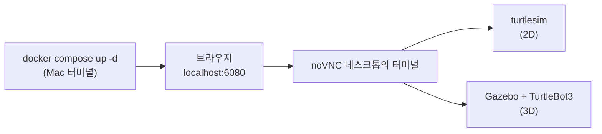

# 기동 방법 정리 — 컨테이너 · turtlesim · Gazebo 3D

> 이 문서는 `ros2-dev` 컨테이너를 띄우고, 그 안에서 **turtlesim(2D)** 과 **Gazebo + TurtleBot3(3D)** 를
> 실행하는 방법을 순서대로 정리한 것이다. 실제로 기동해 보고 확인한 결과(2026-10-12)를 함께 적었다.
> 용어와 전체 흐름은 [getting-started.md](getting-started.md) 를 먼저 본다.

## 목차

1. [전체 흐름](#1-전체-흐름)
2. [컨테이너 기동](#2-컨테이너-기동)
3. [turtlesim 기동 (2D)](#3-turtlesim-기동-2d)
4. [Gazebo + TurtleBot3 기동 (3D)](#4-gazebo--turtlebot3-기동-3d)
5. [종료 방법](#5-종료-방법)
6. [자주 겪는 문제](#6-자주-겪는-문제)

---

## 1. 전체 흐름



| 단계 | 어디서 | 명령 |
|---|---|---|
| 컨테이너 기동 | Mac 터미널 (`learn-ros/`) | `docker compose up -d` |
| 데스크톱 접속 | 브라우저 | http://localhost:6080 |
| 2D 시뮬레이터 | 컨테이너 터미널 | `ros2 run turtlesim turtlesim_node` |
| 3D 시뮬레이터 | 컨테이너 터미널 | `ros2 launch turtlebot3_gazebo turtlebot3_world.launch.py` |

---

## 2. 컨테이너 기동

`learn-ros/` 폴더에서 실행한다.

```bash
docker compose up -d                       # 기동 (없으면 생성, 설정이 바뀌었으면 재생성)
docker ps --filter name=ros2-dev           # 상태 확인 — STATUS 가 Up 이면 정상
curl -s -o /dev/null -w "%{http_code}\n" http://localhost:6080   # 200 이면 noVNC 정상
```

접속 방법은 두 가지다.

| 방법 | 용도 |
|---|---|
| 브라우저 http://localhost:6080 | 리눅스 데스크톱 화면. GUI(turtlesim, Gazebo, RViz)를 보려면 이쪽 |
| `docker exec -it ros2-dev bash` | Mac 터미널에서 바로 컨테이너 셸 진입. 명령만 칠 때 편하다 |

컨테이너 주요 설정 (`docker-compose.yml`):

| 항목 | 값 | 의미 |
|---|---|---|
| `ROS_DOMAIN_ID` | 7 (기본값) | 같은 번호끼리만 노드가 서로 보인다 |
| `ROS_LOCALHOST_ONLY` | 1 | 컨테이너 밖 네트워크로 ROS 통신이 새지 않게 함 |
| 볼륨 | `./ros2_ws` ↔ `/home/ubuntu/ros2_ws` | 작업 폴더는 컨테이너를 지워도 남는다 |
| 포트 | 6080 → 80 | noVNC 웹 화면 |

> **주의** — `docker compose up -d` 가 "Recreate" 를 출력하면 컨테이너가 새로 만들어진 것이다.
> `ros2_ws` 는 유지되지만, 컨테이너 안에서 `apt install` 등으로 바꾼 내용은 사라진다.

---

## 3. turtlesim 기동 (2D)

### noVNC 데스크톱 터미널에서 (권장)

```bash
# 터미널 1 — 시뮬레이터 창이 뜬다
ros2 run turtlesim turtlesim_node

# 터미널 2 — 키보드(화살표)로 조종
ros2 run turtlesim turtle_teleop_key
```

### Mac 터미널에서 원격으로 띄울 때

`docker exec` 는 기본이 **root** 이고 화면 정보가 없어서 창이 뜨지 않는다.
**`ubuntu` 사용자 + `DISPLAY` + `XAUTHORITY`** 를 함께 지정해야 noVNC 화면에 창이 나타난다.

```bash
docker exec -d -u ubuntu ros2-dev bash -c '
  source /opt/ros/jazzy/setup.bash &&
  export DISPLAY=:1 XAUTHORITY=/home/ubuntu/.Xauthority &&
  setsid ros2 run turtlesim turtlesim_node > /home/ubuntu/turtlesim.log 2>&1'
```

| 옵션 | 이유 |
|---|---|
| `-d` | 백그라운드 실행 (터미널을 붙잡지 않음) |
| `-u ubuntu` | 데스크톱 화면의 주인이 `ubuntu` 다. root 로 띄우면 `Authorization required` 오류 |
| `DISPLAY=:1` | noVNC 데스크톱 화면 번호 |
| `setsid` | 별도 프로세스 그룹으로 띄워, 나중에 이것만 골라 끌 수 있게 함 |
| 로그 경로 `/home/ubuntu/...` | `ubuntu` 가 쓸 수 있는 위치여야 한다 (root 가 만든 `/tmp` 파일엔 못 씀) |

### 정상 기동 확인

로그에 아래 두 줄이 보이면 된다.

```
[INFO] [turtlesim]: Starting turtlesim with node name /turtlesim
[INFO] [turtlesim]: Spawning turtle [turtle1] at x=[5.544445], y=[5.544445], theta=[0.000000]
```

---

## 4. Gazebo + TurtleBot3 기동 (3D)

필요한 패키지(`ros-jazzy-ros-gz`, `ros-jazzy-turtlebot3*`)는 이미지에 들어 있어 **추가 설치가 필요 없다**.
로봇 모델은 `.bashrc` 에서 `TURTLEBOT3_MODEL=burger` 로 지정되어 있다.

### noVNC 데스크톱 터미널에서 (권장)

```bash
# 터미널 1 — Gazebo 3D 월드 + TurtleBot3 로봇
ros2 launch turtlebot3_gazebo turtlebot3_world.launch.py

# 터미널 2 — 키보드 조종 (w/x: 전진·후진, a/d: 회전, s: 정지)
ros2 run turtlebot3_teleop teleop_keyboard

# 터미널 3 (선택) — RViz 로 센서 데이터 시각화
rviz2      # Fixed Frame: odom → Add → LaserScan, Topic: /scan
```

### Mac 터미널에서 원격으로 띄울 때

```bash
docker exec -d -u ubuntu ros2-dev bash -c '
  source /opt/ros/jazzy/setup.bash &&
  export DISPLAY=:1 XAUTHORITY=/home/ubuntu/.Xauthority TURTLEBOT3_MODEL=burger &&
  setsid ros2 launch turtlebot3_gazebo turtlebot3_world.launch.py > /home/ubuntu/tb3_gazebo.log 2>&1'
```

`docker exec` 로 띄우면 `.bashrc` 를 읽지 않으므로 `TURTLEBOT3_MODEL` 을 직접 지정해야 한다.

### launch 파일이 띄우는 것

| 프로세스 | 역할 |
|---|---|
| `gz sim -s` | Gazebo **서버** — 물리 계산 (화면 없음) |
| `gz sim -g` | Gazebo **GUI** — 3D 화면 표시 |
| `parameter_bridge` | Gazebo ↔ ROS 2 토픽 연결 (`/scan`, `/odom`, `/cmd_vel` 등) |
| `robot_state_publisher` | 로봇 관절 구조(TF)를 발행 |
| `create` | 월드에 로봇을 생성(spawn)하고 종료 |

### 정상 기동 확인

```bash
grep "Entity creation successful" /home/ubuntu/tb3_gazebo.log   # 로봇 생성 성공
ros2 topic list                                                  # /scan /odom /cmd_vel /imu /tf ...
ros2 topic hz /scan                                              # 약 4.7Hz 면 정상
```

2026-10-12 기동 결과:

| 항목 | 결과 |
|---|---|
| 기동~로봇 생성 | 약 20초 이내 |
| 생성된 토픽 | `/clock` `/cmd_vel` `/imu` `/joint_states` `/odom` `/robot_description` `/scan` `/tf` `/tf_static` |
| LiDAR `/scan` | 평균 4.7Hz |
| CPU | GUI(`gz sim -g`) 약 1.5코어 — GPU 가 없어 CPU 로 화면을 그리기 때문 |

> 속도 명령 토픽 타입이 turtlesim 과 다르다 (`Twist` → **`TwistStamped`**).
> 자세한 차이는 [getting-started.md §7](getting-started.md#7-2차수-준비-gazebo-미로-환경-검증-완료) 참고.

### 미로 + 자동 주행 (turtlebot3_maze 패키지)

```bash
cd ~/ros2_ws && colcon build --packages-select turtlebot3_maze && source install/setup.bash
ros2 launch turtlebot3_maze maze.launch.py navigator:=jev_navigator     # OpenJev 판단 (OpenJev :31001 필요)
ros2 launch turtlebot3_maze maze.launch.py navigator:=wall_follower     # 오른손 벽 따라가기
ros2 launch turtlebot3_maze maze.launch.py gui:=false ...               # 화면 없이 (CPU 절약)
```

`turtlebot3_world` 와 미로를 **동시에** 띄우면 Gazebo 끼리 섞인다. 하나를 끄거나, 한쪽에 `GZ_PARTITION`·`ROS_DOMAIN_ID` 를 다르게 준다.
결과와 해석은 [OpenJev 미로 탐색 검증 결과](../architecture/OpenJev_미로탐색_검증결과_및_장단점.md) 참고.

---

## 5. 종료 방법

| 대상 | 방법 |
|---|---|
| 터미널에서 띄운 노드 | 해당 터미널에서 `Ctrl+C` |
| `setsid` 로 원격 기동한 노드 | 프로세스 그룹 번호(PGID)를 찾아 그 그룹만 종료 (아래) |
| 컨테이너 | Mac 에서 `docker compose stop` (다시 켤 땐 `docker compose up -d`) |

```bash
# 1) PGID 확인
docker exec -u ubuntu ros2-dev ps -eo pid,pgid,cmd | grep -E "turtlesim|gz sim|ros2 launch"

# 2) 그 그룹만 종료 (예: PGID 가 958 인 경우)
docker exec -u ubuntu ros2-dev kill -INT -- -958
```

> **`pkill -f turtlesim_node` 처럼 이름으로 끄지 않는다.**
> 같은 컨테이너에서 noVNC 로 직접 띄운 다른 사람(또는 내) 프로세스까지 함께 죽는다.

---

## 6. 자주 겪는 문제

| 증상 | 원인 | 해결 |
|---|---|---|
| `Authorization required` / `could not connect to display :1` | root 로 실행했거나 `DISPLAY`/`XAUTHORITY` 누락 | `-u ubuntu` + `DISPLAY=:1 XAUTHORITY=/home/ubuntu/.Xauthority` |
| `docker exec` 로 띄웠는데 아무 일도 안 일어남 | 로그 파일 경로에 쓰기 권한이 없어 명령이 시작되지 않음 | 로그를 `/home/ubuntu/` 아래로 |
| `ros2 node list` 가 비어 있음 | 띄운 직후라 아직 발견(discovery) 전, 또는 `ROS_DOMAIN_ID` 가 다름 | 몇 초 뒤 다시 확인, `echo $ROS_DOMAIN_ID` 로 양쪽 번호 비교 |
| Gazebo 화면이 끊김 | GPU 없이 CPU 로 그림 | 정상. 시뮬레이션 자체(서버)는 영향이 적다 |
| `TURTLEBOT3_MODEL` 관련 오류 | `docker exec` 는 `.bashrc` 를 읽지 않음 | `export TURTLEBOT3_MODEL=burger` 추가 |
| `ROS_LOCALHOST_ONLY is deprecated` 경고 | Jazzy 에서 바뀐 설정 방식 안내 | 동작에는 문제 없음, 무시 |
